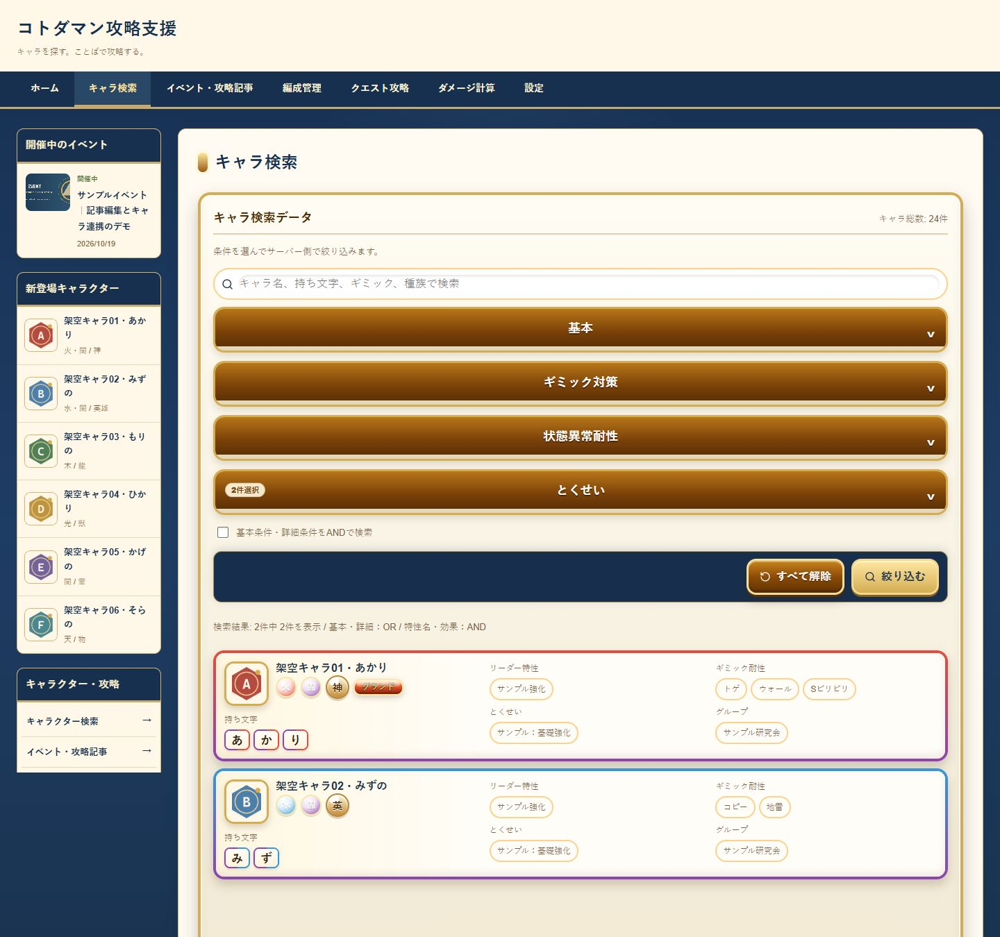
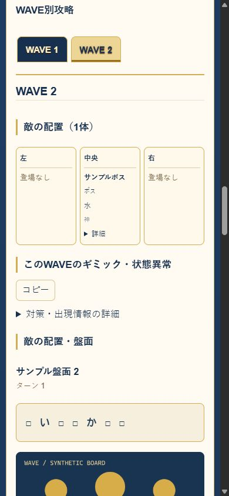

# Kotodaman Guide Tools

コトダマンのキャラクター検索、編成支援、攻略記事作成を目的とした個人開発Webアプリケーションです。

**このリポジトリは技術紹介用のサンプル版です。** 実際のキャラクターDB、制作中の記事、ゲーム画像、外部攻略サイトからの取得データ、元プロジェクトのGit履歴は含めていません。24件の架空キャラクターと、新規作成した図形画像でローカル動作を確認できます。

ゲーム運営会社・権利者の公式サイトではありません。サンプルの性能値・イベント・攻略内容はすべて架空です。

## スクリーンショット

画像は同梱の架空データとオリジナル図形素材だけを使って撮影しています。

### キャラ検索（PC）



### クエスト攻略記事（スマホ）



## 使用技術

| 分野 | 技術 |
| --- | --- |
| アプリケーション | Next.js 16.3.8 / App Router、React 19、TypeScript |
| エディター | Tiptap 3.31.4、構造化JSON、テーブル・文字装飾・独自キャラブロック |
| 画像 | Sharp 0.35.5、WebP等の事前生成、サイズ別画像、IntersectionObserver |
| UI | CSSによるレスポンシブ3カラム、Lucide React |
| データ保存 | ローカルJSON、revisionによる競合検出、一時ファイルと復旧を用いた保存 |
| 検証 | Node.js組み込みテスト、ESLint、TypeScript、Playwrightによるローカル表示検証 |

## 主な機能

- 属性・種族・持ち文字・ギミック・特性による複合キャラ検索
- 特性名・効果カテゴリ・詳細テンプレートの異なる軸での検索、AND／OR、通常・祝福・大討伐の区分
- キャラ詳細、12枠の編成管理、条件保持、検索操作バーと検索後スクロール
- Tiptapによる記事本文・文字色・背景色・表・画像・キャラリンク・キャラカードの編集
- イベント施策ごとの構造化された期間、目次、本文編集、開催状態の判定
- クエスト記事の敵・配置・ギミック・状態異常・複数軸・盤面・ボム・適正理由・WAVE別解説
- 「未確認」「確認済み」「該当なし」を区別した公開前チェック
- 新キャラ／おすすめ記事のIDによる表示設定と、公開記事だけの新着表示
- ローカル管理画面、下書き非公開、画像アップロード・最適化・タップ拡大

ダメージ計算、PVランキング、高度な自動適正推薦は完成機能として扱っていません。本番ホスティング、広告、クラウド画像ストレージは未接続です。

## 技術的な工夫

**検索の分類軸を分離。** 表記された特性名と効果カテゴリ、詳細テンプレートを分け、似た効果だけで異なる名称を同一視しない構造にしています。名称の取得状況と本文の取得状況も区別します。

**データと解説の二重管理を抑制。** 開催期間・敵・盤面・ボム条件等は型のある共通データを正とし、説明文はTiptapの構造化データで管理します。閲覧画面と編集プレビューで同じレンダラーを使います。

**公開とローカル編集を分離。** 本番では管理画面・管理APIをサーバー側で拒否し、編集用JSONへフォールバックしません。公開用書き出しは記事IDの明示選択と参照画像の整合性を確認します。管理UIコードのビルドからの完全除外は未実施です。

**画像は参照ID・メタデータと分離。** 原本を私有保存し、表示用masterと必要な幅の軽量版を生成します。公開画像の書き出しに下書き・未使用画像・原本を混ぜない設計です。

**安全な保存と復元。** revisionが合わない保存を拒否し、複数JSONの更新失敗時の復旧、下書き復元、未保存警告を備えています。

詳しい構成は[アーキテクチャ](docs/architecture.md)、データと画像の範囲は[素材・データの来歴](docs/data-provenance.md)を参照してください。

## ローカルで動かす

Node.js 24.x / npmを使用します。外部DBや有料APIは必要ありません。

```sh
npm ci --ignore-scripts
npm run check:public
npm test
npm run typecheck
npm run lint
npm run dev
```

ブラウザで `http://127.0.0.1:3000` を開きます。開発サーバーはループバックアドレスに限定しています。ポートを変える場合は `npm run dev -- --port 3100` を使ってください。

- `/characters`：24件の架空キャラを検索
- `/articles/demo-event`：架空イベントの記事
- `/articles/demo-quest`：2つのWAVEを持つ架空クエスト記事
- `/team`：編成管理

### ローカルの記事編集

```sh
npm run setup:local-admin
npm run dev
```

生成された、Git対象外の`.env.local`をローカルで開き、`ADMIN_PASSWORD`を確認します。`/admin`へ直接アクセスして入力してください。秘密値をREADMEやIssueへ貼らないでください。既存の`.env.local`は上書きしません。自分で設定する場合は`.env.example`を参照できます。

編集用データは`data/articles.json`、公開用サンプルは`content/public/`です。保存しただけでは本番側の公開内容は変わりません。本物の記事やゲーム画像をこの公開用サンプル版へ追加しないでください。

### 本番モードをローカルで検証

```sh
npm run build
npm run start
```

standalone成果物へ静的ファイルをコピーして`127.0.0.1`で起動します。本番モードでは管理画面・管理API・架空の下書きURLは404です。公開画像は同梱のオリジナル素材だけです。

サンプルを作り直す`npm run demo:reset`は、**このコピー内のデモ編集内容を上書きする操作**です。通常の起動・ビルドには不要です。

## テストの範囲

公開版では実データに依存する回帰テストを外し、架空データの整合性・分類・記事・画像・公開制御のテストに置き換えています。元の完全なプロジェクトのテスト結果と、公開サンプル版の結果は別です。

CI用のワークフローは読み取り専用権限で、依存関係・テスト・型・lint・buildを確認する構成です。リポジトリ登録前のため、GitHub Actionsでの実行結果や公開サイトの稼働実績はありません。

## 開発状況・制限

- ローカルで編集して、完成した公開用データだけを反映する運用を想定しています。
- 公開用キャラデータは24件のみです。実ゲーム全体の検索精度・負荷をこのサンプルだけで再現するものではありません。
- `https://example.com/portfolio/...`は参照形式を示す予約済みドメインのプレースホルダーで、実際の公式情報へのリンクではありません。
- 管理UIコードはソース紹介のため含みます。本番でのサーバー側遮断と、コード自体を配布しないことは別です。
- コード閲覧用として、現時点で明示的なOSSライセンスは付与しません。GitHub公開・外部デプロイは所有者の最終確認待ちです。
- 依存監査では開発用のHigh 5件が残っています。実行時依存は0件でした。影響範囲と更新方針は[依存関係の監査メモ](docs/dependency-security.md)を参照してください。

## ライセンス・第三者の権利

**コード閲覧を目的としたポートフォリオです。現時点でMIT等の明示的なOSSライセンスは付与しません。** 利用条件は[LICENSE_STATUS.md](LICENSE_STATUS.md)を参照してください。

ゲーム名等の権利は各権利者に帰属します。このリポジトリはゲーム画像や外部攻略データの再利用を許諾しません。依存ライブラリには各ライセンスが適用されます。[THIRD_PARTY_NOTICES.md](THIRD_PARTY_NOTICES.md)
