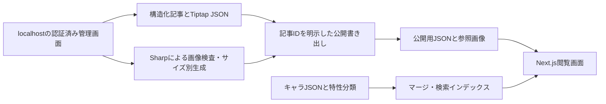

# アーキテクチャ

イベントは施策・期間・本文ブロック、クエストは敵・配置・ギミック・盤面・ボム・WAVE等を構造化します。Tiptapの本文は共通データを複製せず、IDによるキャラ参照と、説明文を持ちます。

画像は記事本文へバイナリを埋めず、ID・幅高さ・形式・用途・ハッシュ等を分離します。公開用出力とローカルの私有画像を分け、原本・下書き画像を一般配信しません。

現在はSSRとNodeファイル読み込みを使います。静的ホストへそのまま置ける構成ではありません。公開版ではサーバーAPIの全件キャッシュ再構築パラメータを無効化し、内部のファイルエラーをレスポンスに出さないようにしています。

管理APIは各エンドポイントと本番モードの入口で拒否します。管理コードをビルドから完全に除く別アプリ化は未実施です。
